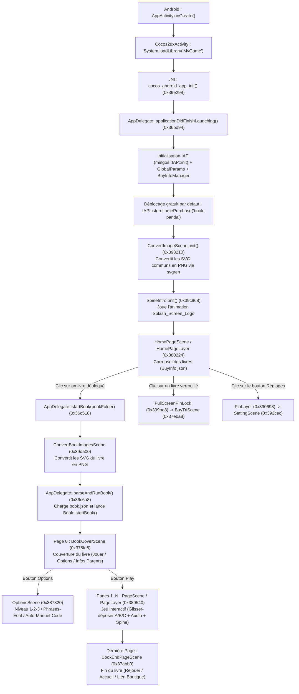

# Architecture C++ Décompilée — PicoPhrase (`libMyGame.so`)

Ce dossier contient la reconstruction en C++ lisible (pseudo-code fidèle extrait du binaire ARM64 [`app/src/main/jniLibs/arm64-v8a/libMyGame.so`](../app/src/main/jniLibs/arm64-v8a/libMyGame.so)) de **toutes les classes métier** du jeu **PicoPhrase** (`com.symbolicone.ouille`), développé avec le moteur **Cocos2d-x C++**.

> **Note** : Ce dossier est purement documentaire afin d'analyser et de comprendre le fonctionnement interne du projet. Il n'est pas compilé par Gradle (qui utilise directement le binaire précompilé `libMyGame.so`).

---

## 1. Flux d'exécution global (Du lancement Android à la lecture d'un livre)

---

## 2. Organisation des fichiers dans `cpp_decompiled/`

| Fichier | Classes C++ incluses | Rôle dans le jeu |
| :--- | :--- | :--- |
| [`BookSettings.h`](./BookSettings.h) | `BookSettings`, `GlobalParams`, `PositionManager`, `PageLogicManager` | Structures d'état (langue, niveau, mode de lecture), paramètres globaux (`global.json`) et calcul des coordonnées à l'écran. |
| [`AppDelegate.cpp`](./AppDelegate.cpp) | `AppDelegate`, `cocos_android_app_init` | Point d'entrée C++, initialisation OpenGL/Audio/IAP, lancement d'un livre et ouverture des URL externes. |
| [`ConvertAndIntroScenes.cpp`](./ConvertAndIntroScenes.cpp) | `ConvertImageScene`, `ConvertBookImagesScene`, `SpineIntro` | Conversion au démarrage des fichiers vectoriels `.svg` en `.png` à la résolution de l'appareil (en tâche de fond `std::thread`), puis logo animé Spine. |
| [`HomePage.cpp`](./HomePage.cpp) | `HomePageScene`, `HomePageLayer` | Écran principal avec le carrousel de sélection des livres, flèches gauche/droite, cadenas et bouton de restauration d'achats. |
| [`BookAndPages.cpp`](./BookAndPages.cpp) | `Book`, `BookCoverScene`, `TitlePageScene`, `PageScene`, `PageLayer`, `BookEndPageScene` | Toute la logique d'un livre interactif : lecture de `book.json`, glisser-déposer des pictogrammes dans les 3 zones (`HotZone` A, B, C), sons `.mp3`, animations Spine `.sbin`/`.atlas`. |
| [`SettingsAndMenus.cpp`](./SettingsAndMenus.cpp) | `OptionsScene`, `SettingScene`, `OrthopictoSettingsLayer`, `InformationSettingsLayer`, `LanguageSettingsLayer`, `RateSettingsLayer` | Écran d'options d'un livre (Niveaux 1/2/3, Phrases/Écrit, Auto/Manuel/Code) et menu général à 5 onglets (Orthopicto, Infos, Langues QC/FR/EN, Boutique, Notation). |
| [`ShopAndIAP.cpp`](./ShopAndIAP.cpp) | `BuyInfoManager`, `IAPListen`, `mingos::IAP`, `BuyTriScene`, `BuyTriLayer`, `ShopSettingsLayer`, `ScrollShopItemNode`, `OptionsBuyInfoLayer` | Gestion du catalogue `BuyInfo.json`, pont JNI vers `iap/PurchaseManager.java`, callbacks JNI `PurchaseEventListener`, déblocage des packs (`bundle1`..`bundle7`) et interfaces de boutique. |
| [`PinLocksAndUIHelpers.cpp`](./PinLocksAndUIHelpers.cpp) | `PinLayer`, `FullScreenPinLock`, `ImageDatabase`, `SingleImageLayer`, `ColourLabelParser`, `MYLabel` | Contrôle parental par code PIN aléatoire, base d'images multilingue (`imagedatabase.json`) et parseur de textes colorés. |

---

## 3. Table des adresses dans `libMyGame.so` (ARM64)

Toutes les classes spécifiques à PicoPhrase se situent dans la section `.text` entre **`0x0036bbc8`** et **`0x003aa980`** :

| Classe C++ | Plage d'adresses (`.text`) | Nombre de méthodes |
| :--- | :--- | :---: |
| `BookSettings` | `0x0036bbc8` – `0x0036bbdc` | 1 (+ accès directs aux champs) |
| `AppDelegate` | `0x0036bc54` – `0x0036cdf4` | 18 |
| `HelloWorld` *(inutilisé, template Cocos)* | `0x0036d4d0` – `0x0036d9d0` | 4 |
| `Book` | `0x0036db24` – `0x0036e7f8` | 12 |
| `BookCoverScene` | `0x00378f20` – `0x00379f24` | 12 |
| `BookEndPageScene` | `0x0037aaec` – `0x0037b9f8` | 9 |
| `BuyInfoManager` | `0x0037bcb0` – `0x0037c2fc` | 2 |
| `BuyTriLayer` | `0x0037c7f0` – `0x0037e654` | 8 |
| `BuyTriScene` | `0x0037eabc` – `0x0037f01c` | 6 |
| `ColourLabelParser` & `MYLabel` | `0x0037f0d8` – `0x0037f9d4` | 4 |
| `GlobalParams` | `0x0037fc34` – `0x00380168` | 8 |
| `HomePageLayer` | `0x00380168` – `0x003820dc` | 19 |
| `HomePageScene` | `0x00382560` – `0x003828e8` | 5 |
| `ImageDatabase` | `0x003828e8` – `0x00382f34` | 7 |
| `InformationSettingsLayer` | `0x00384b04` – `0x0038573c` | 9 |
| `LanguageSettingsLayer` | `0x00385898` – `0x0038656c` | 10 |
| `OptionsBuyInfoLayer` | `0x00386628` – `0x00387190` | 8 |
| `OptionsScene` | `0x0038724c` – `0x003884c4` | 15 |
| `OrthopictoSettingsLayer` | `0x00388714` – `0x00389058` | 8 |
| `PageLayer` | `0x003891f0` – `0x0038e608` | 33 |
| `PageLogicManager` | `0x0038fb64` – `0x0038fc90` | 11 |
| `PageScene` | `0x0038fc90` – `0x003902fc` | 10 |
| `PinLayer` | `0x003902fc` – `0x003912e4` | 10 |
| `PositionManager` | `0x0039265c` – `0x003928cc` | 11 |
| `RateSettingsLayer` | `0x003928cc` – `0x00392f48` | 8 |
| `ScrollShopItemNode` | `0x003930c4` – `0x00393b24` | 8 |
| `SettingScene` | `0x00393bb0` – `0x00394c3c` | 13 |
| `ShopSettingsLayer` | `0x00394dbc` – `0x00395ecc` | 11 |
| `SingleImageLayer` | `0x00396464` – `0x00396614` | 6 |
| `TitlePageScene` | `0x00396614` – `0x00397204` | 12 |
| `ConvertImageScene` & `ConvertBookImagesScene` | `0x003972c0` – `0x0039e278` | 14 |
| `FullScreenPinLock` | `0x00399af0` – `0x0039ab30` | 11 |
| `IAPListen` & `mingos::IAP` | `0x0039afc0` – `0x003aa980` | 43 |
| `SpineIntro` | `0x0039c8c4` – `0x0039cf24` | 6 |

---

## 4. Événements personnalisés (`cocos2d::EventCustom`)

Le jeu utilise le bus d'événements de Cocos2d-x (`Director::getInstance()->getEventDispatcher()`) pour communiquer entre les calques (`Layer`), les scènes (`Scene`) et le contrôleur `Book` :

- **`"next_page"`** : Déclenche `Book::gotoNextPage()` avec une transition de page tournée (`TransitionPageTurn`).
- **`"prev_page"`** : Déclenche `Book::gotoPrevPage()`.
- **`"reload_book"`** : Recharge le fichier `book.json` et la page courante (`Book::reloadBook()`).
- **`"restart_book"`** : Retourne à la première page du livre (`Book::restartBook()`).
- **`"lang_changed"`** : Émis par `LanguageSettingsLayer` quand l'utilisateur choisit Français, Québécois ou Anglais ; met à jour dynamiquement toutes les interfaces abonnées (`HomePageLayer`, `PinLayer`, `ShopSettingsLayer`, etc.).
- **`"purchasemade"`** : Émis par `IAPListen::onPurchaseSuccessInternal()` lorsqu'un achat ou une restauration réussit ; met à jour les cadenas dans la boutique (`ScrollShopItemNode`) et l'accueil.

---

## 5. Clés de sauvegarde (`UserDefault` / `Cocos2dxPrefsFile.xml`)

Lorsque le code C++ appelle `cocos2d::UserDefault::getInstance()`, il passe par JNI vers [`Cocos2dxHelper.java`](../app/src/main/java/org/cocos2dx/lib/Cocos2dxHelper.java) qui lit/écrit dans les `SharedPreferences` Android :

- **`"lang"`** (`int`) : Langue active (`0` = Français, `1` = Anglais, `2` = Québécois).
- **`"opens"`** (`int`) : Compteur du nombre d'ouvertures de l'application (incrémenté dans `applicationWillEnterForeground`).
- **`"book-panda"`**, **`"book-ant"`**, **`"book-hurt"`**, **`"book-eat"`**, etc. (`bool`) : État de déblocage de chaque livre ou pack (`getBoolForKey` / `setBoolForKey`).

